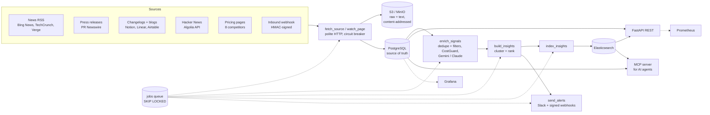

# Signal Scout: AI Competitor Insights Pipeline

Watches competitors' news, press releases, and website changes, uses Claude or Gemini to turn them into ranked insights, and serves them over search, Slack alerts, and an MCP server for AI agents.

[](https://github.com/asmipahwa/signal-scout/actions/workflows/ci.yml)


**LLM provider:** Claude adapter built and tested; production run on Gemini.

> Every number below comes from a real run, with the raw output linked. Nothing is estimated or simulated.
> Work in progress is marked as such.

## Who it's for

- **A sales rep** walking into a competitive deal: "What did ClickUp ship this month, and how do I handle it?"
- **A product marketer** tracking launches, pricing changes, and messaging shifts across a competitive set.

Each insight says *what changed* and *why it matters for a seller*, ranked so the important items come first.
The tracked set is 8 project-management competitors (Asana, monday.com, ClickUp, Notion, Smartsheet,
Airtable, Linear, Atlassian), configured in [`seeds/competitors.yaml`](seeds/competitors.yaml).

## Architecture



Every stage runs as a job on a Postgres queue (`SELECT ... FOR UPDATE SKIP LOCKED`), scheduled by APScheduler,
and every job execution writes a `job_runs` row. Design rationale: [`docs/DESIGN.md`](docs/DESIGN.md).

## Results so far

| Metric | Value | Evidence |
|---|---|---|
| Signals ingested and run through the funnel | **10,317** (9,769 Hacker News, 407 changelog, 106 news, 20 press release, 15 blog) as of 2026-10-31 | [`runs-report.txt`](docs/results/2026-10-31-backfill/runs-report.txt) |
| Passed dedupe + relevance filters (queued for the LLM) | 5,878 | same |
| Pricing pages under change monitoring | 8 (baselines stored; no changes detected yet) | [`source-report.txt`](docs/results/2026-10-31-backfill/source-report.txt) |
| Pipeline throughput (historical backfill) | **48,561 signals/hour** through the full ingestion path | [`backfill-job-runs.txt`](docs/results/2026-10-31-backfill/backfill-job-runs.txt) |
| Enrichment quality (101 labeled real signals, prompt v3) | relevance 93.1%, recall **100%**, category 81.8%, importance ±1 97.0% | [`docs/EVALS.md`](docs/EVALS.md) |
| Important signals that reach the feed (eval) | **100%** (38/38) | [`docs/EVALS.md`](docs/EVALS.md) |
| LLM cost | **$0** so far (Gemini free tier); $0.82 per 1,000 enrichments at paid Flash-Lite list prices | [`prototype run`](docs/results/2026-10-31-prototype/) |
| Pre-LLM filter on labeled set | drops 16/35 irrelevant signals, 0/66 relevant | [`relevance-and-clustering.txt`](docs/results/2026-10-31-processing/relevance-and-clustering.txt) |
| Tests | 231 passing (unit + integration on real Postgres, MinIO, Elasticsearch) | CI |
| Search p95 under load | **not yet measured at scale**: the insight index fills as the free-tier LLM works through the backlog (500 requests/day) | [`docs/PERFORMANCE.md`](docs/PERFORMANCE.md) |

## Quickstart

Requires Docker and [uv](https://docs.astral.sh/uv/). For enrichment, a free Gemini API key from
[Google AI Studio](https://aistudio.google.com), stored in the macOS Keychain (never in the repo):

```sh
security add-generic-password -U -a "$USER" -s signal-scout-gemini -w   # paste the key once
make up && make migrate && make seed      # Postgres 16, Elasticsearch 8, MinIO; 8 competitors, 33 sources
make app                                  # api, 2 workers, scheduler, MCP, Prometheus, Grafana (Docker)
make backfill SINCE=2016-01-01            # optional: historical Hacker News stories
make runs-report                          # the funnel, straight from Postgres
open http://localhost:3000                # Grafana dashboard
```

Without Docker for the app processes: `make worker`, `make scheduler`, `make api`, `make mcp`.
Tests: `make test` (unit, no network) and `make it` (integration, testcontainers).

## Swapping providers

Enrichment goes through one `LLMClient` interface with two real adapters (Gemini via `google-genai`, Claude
via `anthropic`). Both return the same validated `Enrichment`, so switching is one environment variable:

```sh
LLM_PROVIDER=claude   # or gemini (default); optionally LLM_MODEL=<model id>, LLM_PROMPT_VERSION=v1|v2|v3
```

## API

`make api` serves a FastAPI app on `API_HOST:API_PORT` (default `127.0.0.1:8000`); OpenAPI docs are at
`/docs`. `make env` generates a random local `API_KEY` and `INBOUND_WEBHOOK_SECRET` in `.env`.

| Endpoint | What it returns |
|---|---|
| `GET /api/v1/insights` | Ranked feed (score desc), filters `competitor`, `category`, `min_importance`, `days`; opaque `cursor` pagination |
| `GET /api/v1/insights/{id}` (`/sources`) | One insight with its linked signals (title, URL, source type, date) |
| `GET /api/v1/search` | Elasticsearch search: `q`, `competitor`, `category`, `from`, `to`, `min_importance`, `page`, `size`; highlights, `total`, `took_ms` |
| `GET /api/v1/competitors`, `/competitors/{id}/brief` | Tracked competitors; a brief with top insights, counts by category, pricing and page changes |
| `GET /api/v1/changes`, `/compare` | Recent pricing changes / launches / page diffs; side-by-side counts |
| `GET /api/v1/signals/{id}` | Signal metadata plus a presigned S3 URL for the raw object (expires after 15 minutes) |
| `POST/GET/DELETE /api/v1/webhooks`, `GET /api/v1/webhooks/{id}/deliveries` | Outbound webhooks; the signing secret is returned only once, at creation |
| `POST /api/v1/ingest/webhook` | Inbound signal, HMAC-signed (`X-SignalScout-Signature`); bad or stale signatures get 401 |
| `GET /api/v1/runs` | The `job_runs` audit log |
| `GET /healthz`, `/readyz`, `/metrics` | Liveness; readiness of Postgres, ES and S3 (503 with per-dependency status); Prometheus |

Reads are public; `POST`/`DELETE /api/v1/webhooks` need `X-API-Key`. Every error is RFC 9457
`application/problem+json`:

```sh
curl -s 'localhost:8000/api/v1/search?q=pricing&competitor=Notion&size=5'
curl -s 'localhost:8000/api/v1/insights?limit=10'          # then pass next_cursor back as ?cursor=
curl -s -X POST localhost:8000/api/v1/webhooks -H "X-API-Key: $API_KEY" \
  -H 'content-type: application/json' -d '{"name":"sales","url":"https://example.com/hook","filters":{"min_importance":4}}'
curl -s -X POST localhost:8000/api/v1/webhooks -d '{}' -H 'content-type: application/json'
# {"type":"about:blank","title":"Unauthorized","status":401,"detail":"missing or invalid X-API-Key header",...}
```

Signing an inbound signal (same scheme as outbound deliveries: HMAC-SHA256 over `<timestamp>.<raw body>`):

```sh
BODY='{"title":"Acme adds an AI tier","url":"https://example.com/acme-ai","text":"...","competitors":["Asana"]}'
SIG=$(uv run python -c "import sys; from signal_scout.alerts.signing import sign; print(sign(sys.argv[1], sys.argv[2].encode()))" "$INBOUND_WEBHOOK_SECRET" "$BODY")
curl -s -X POST localhost:8000/api/v1/ingest/webhook -H 'content-type: application/json' \
  -H "X-SignalScout-Signature: $SIG" -d "$BODY"
# {"signal_id":7,"created":true,"s3_key":"raw/...","status":"new"}
```

The curl calls above were run by hand against a throwaway local stack seeded with the integration-test
fixture data (invented insights, not real news).

## MCP

`src/signal_scout/mcp_server.py` is an MCP server (official `mcp` Python SDK v2, where FastMCP is now
`MCPServer`) so AI agents can query the same data. All tools are read-only and call the same services
as the REST API. Each call is logged with its arguments and latency and recorded in `job_runs` as
`mcp_tool:<name>`.

| Kind | Name |
|---|---|
| Tools | `search_insights(query, competitor?, category?, days?, limit?)`, `get_competitor_brief(competitor, days=30)`, `list_recent_changes(competitor?, change_type?, days=7)`, `compare_competitors(competitors, days=30)`, `get_signal_sources(insight_id)` |
| Resources | `competitors://list`, `insights://top` (head of the ranked feed) |
| Prompt | `weekly_competitive_digest(competitors?)` |

```sh
make mcp            # Streamable HTTP on MCP_HOST:MCP_PORT (default 127.0.0.1:8001), path /mcp
make mcp-inspect    # MCP Inspector (npx) against the stdio server
uv run python -m signal_scout.mcp_server --transport stdio
```

Checked by hand: the SDK client over both stdio and Streamable HTTP, and MCP Inspector 2.13.0 in CLI
mode (`--cli ... --method tools/list` / `tools/call`), against the same throwaway fixture stack.

### Use it from Claude Desktop

Add this to `claude_desktop_config.json` (macOS: `~/Library/Application Support/Claude/`), with the
absolute path to your checkout. `--directory` makes the server read that checkout's `.env`, so the
stack from `make up` must be running:

```json
{
  "mcpServers": {
    "signal-scout": {
      "command": "uv",
      "args": ["run", "--directory", "/absolute/path/to/signal-scout", "python", "-m", "signal_scout.mcp_server"]
    }
  }
}
```

stdio is the default transport. Logs go to stderr, because stdout carries the protocol. If Claude Desktop
cannot find `uv`, use its absolute path (`which uv`) as `command`.

## Design decisions

- **Postgres queue, not Celery/Kafka.** At this volume a `jobs` table with `SKIP LOCKED` gives retries,
  backoff, dead letters and an audit trail with one less system to run. SQS or Kafka is the move at scale.
- **Elasticsearch, not Postgres full-text.** BM25 blended with a custom rank score, English stemming,
  highlighting and autocomplete, without search load competing with pipeline writes. Postgres stays the
  source of truth; `make reindex` rebuilds the index (tested: identical results).
- **Content-addressed S3.** Raw pages and extracted text are keyed by SHA-256, so identical content is
  stored once and every signal links back to its exact source bytes.
- **Filter before the LLM.** Exact + MinHash near-duplicate dedupe, case-sensitive competitor aliases
  ("the notion that" is not Notion), and low-value title patterns run first; the daily LLM quota is spent
  only on signals that can matter, freshest and most official first.
- **Cheap models, structured output.** Gemini Flash-Lite on the free tier by default; Claude Haiku via a
  strict tool schema. One JSON schema for both, Pydantic validation after, one retry, then
  `enrichment_failed`. 0 failures in 404 eval and prototype calls.
- **Clustering + ranking.** Same competitor, 72-hour window, TF-IDF similarity ≥ 0.2 (category ignored);
  rank = importance × recency (7-day half-life) × source weight × corroboration × novelty. Every
  threshold was measured on real data: [`docs/DESIGN.md`](docs/DESIGN.md).

More: [`DESIGN.md`](docs/DESIGN.md) · [`EVALS.md`](docs/EVALS.md) · [`PROTOTYPE_TO_PROD.md`](docs/PROTOTYPE_TO_PROD.md) ·
[`OBSERVABILITY.md`](docs/OBSERVABILITY.md) · [`PERFORMANCE.md`](docs/PERFORMANCE.md) · [`DEPLOY.md`](docs/DEPLOY.md) ·
[`SPRINT_LOG.md`](docs/SPRINT_LOG.md) · [`INTERVIEW_NOTES.md`](docs/INTERVIEW_NOTES.md)

## Status

Built and tested: ingestion (RSS, Hacker News, pricing-page diffs, signed inbound webhooks), S3 + Postgres
storage, dedupe and filters, LLM enrichment with CostGuard, clustering and ranking, Elasticsearch search,
REST API, MCP server, Slack alerts and signed outbound webhooks, Prometheus + Grafana, Docker image and CI.

In progress: enriching the 5,878-signal backlog within the free tier's 500 requests/day, the search
load test once the index is full, the Claude eval (needs an API key), a Claude Desktop demo, and human
review of the eval labels.

## How I built this with AI tools

I built this with Claude Code as a pair programmer: it drafted code, tests and docs, and parallel
Claude Code agents built Sprint 2 (storage/queue/ingestion) and the API/MCP layer on separate branches
that were then merged. I set the requirements and made the product and scope decisions (which LLM
provider, the budget, what counts as a signal, what to claim). Issues caught along the way, kept as they
happened:

- A test fixture's source URL was written from memory and labeled as real; a check against the cached
  fetch caught it, and it now uses the actual item.
- The first LLM adapters only handled rate limits, so a live 503 crashed the run; fixed with
  transient/permanent error classes and tests built from the real error body.
- The plan used Google News RSS; checking `robots.txt` first showed it's disallowed, so it was dropped.
- Prompt v2 scored best on aggregate accuracy but dropped two important pricing signals; scoring what
  actually reaches the feed changed the decision to v3.
- The seeded Hacker News query `Linear` pulled 3,914 stories about linear algebra; the source report
  exposed it (68 relevant), the query was fixed and the 3,329 off-topic signals deleted
  ([notes](docs/results/2026-10-31-backfill/NOTES.md)).
- The end-to-end integration test caught the enrichment job relying on an attribute outside the
  `LLMClient` interface.

## At Klue's scale

Managed Postgres and Elasticsearch/OpenSearch, a real queue (SQS/Kafka), autoscaled workers per job type,
a shared rate limiter for LLM quotas, and tenant isolation on every row and index. Details in
[`docs/DEPLOY.md`](docs/DEPLOY.md).

## License

MIT
