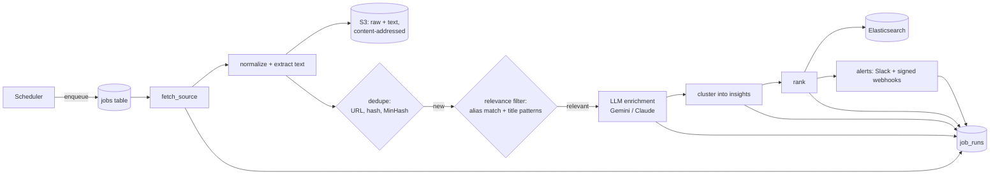

# Design

How Signal Scout turns public signals into ranked insights, and why each piece is built the way it is.
Every threshold below links to the measurement it came from.

## Pipeline



Postgres is the source of truth for every entity (competitors, sources, signals, enrichments, insights,
job runs, webhook deliveries). Raw pages live in S3. Elasticsearch holds a derived search index that can
be deleted and rebuilt from Postgres at any time.

## Filter before the LLM

The LLM is the only step with a per-call cost (money on a paid tier, daily quota on the free tier), so
everything cheap runs first:

1. **Exact dedupe:** canonical URL (tracking parameters stripped) and SHA-256 content hash.
2. **Near-duplicate dedupe:** MinHash LSH over 5-word shingles at an estimated Jaccard similarity of 0.8
   catches syndicated press releases with different boilerplate
   ([`near_dup.py`](../src/signal_scout/processing/near_dup.py)).
3. **Competitor matching:** case-sensitive aliases on word boundaries. "Notion", "Linear", "Monday" and
   "Asana" are ordinary words, so "the notion that..." and "yoga asanas" must not match.
4. **Low-value title patterns:** comparisons ("X vs Y", "alternatives"), reviews, pricing explainers,
   how-tos, and "I replaced X with Y" stories.

Measured on the 101 labeled real signals ([evidence](results/2026-10-31-processing/relevance-and-clustering.txt)):
step 4 drops **16 of 35** irrelevant signals before the LLM and wrongly drops **0 of 66** relevant ones.
What gets through is caught by the LLM's own `is_about_tracked_competitor` field. In the prototype, the
LLM correctly rejected "Asana Partners", a real-estate firm.

## Getting reliable JSON out of an LLM

- One JSON schema shared by every provider. It is deliberately simple (no min/max, no string lengths)
  because providers support different subsets of JSON Schema.
- Gemini: `response_mime_type="application/json"` + `response_json_schema`. Claude: a strict tool
  (`strict: true`) that the model must call.
- Pydantic then validates what schemas can't: numeric ranges, string lengths, and competitors limited to
  the tracked list.
- A response that fails validation is retried once; a second failure marks the signal
  `enrichment_failed` and the pipeline moves on.
- Prototype result: 101 of 101 Gemini responses validated on the first try.

## Provider abstraction

`LLMClient` has two real adapters returning the same `Enrichment`. `LLM_PROVIDER=gemini|claude` switches
between them, with no code changes. The shared base class owns retries and accounting; each adapter is
about 60 lines. This mattered on day one: `gemini-3.8-flash` returned 503 "high demand" errors, and the
prototype run switched to `gemini-3.5-flash-lite` with one environment variable.

Failures are split by what to do about them:

| Error | Example | Handling |
|---|---|---|
| `LlmRateLimitedError` | 429 per-minute quota | wait for the provider's retry hint, retry |
| `LlmTransientError` | 503 overloaded, 5xx, network | exponential backoff with jitter, retry |
| `LlmQuotaExhaustedError` | 429 per-day quota, no credit | stop the run; resume after the reset |
| `LlmRequestError` | 400 bad request | fail this signal only |
| `LlmOutputError` | invalid JSON twice | mark `enrichment_failed` |

A client-side rate limiter keeps requests under the free tier's per-minute and per-day limits. The daily
count is persisted, so a multi-day backfill can stop and resume without exceeding the quota.

## Clustering

Many articles about one event should be one insight. Two signals join a cluster when they are about the
**same competitor**, published **within 72 hours** of the cluster's newest member, and their title + LLM
summary have **TF-IDF cosine similarity ≥ 0.2** ([`clustering.py`](../src/signal_scout/processing/clustering.py)).

Category is deliberately ignored. The prototype required the same category and split one Notion story
(AI credits and 24-hour agents) into five insights across three categories, because the LLM labeled the
same news as pricing in one article and product launch in another.

Threshold choice, on the 65 importance≥2 signals from the prototype
([evidence](results/2026-10-31-processing/relevance-and-clustering.txt)):

| Threshold | Insights | Multi-signal clusters | False merges (manual review) |
|---:|---:|---:|---:|
| prototype method | 59 | 5 | not reviewed |
| 0.4 | 61 | 2 | 0 |
| 0.3 | 58 | 5 | 0 |
| **0.2 (default)** | **50** | **10** | **0** |
| 0.15 | 49 | 10 | 0 |

At 0.2, the ClickUp layoff coverage (3 articles), the Notion–Anthropic outage (5), and the Notion
developer platform launch (3) each become one insight. 0.15 additionally merges a third Notion pricing
article correctly, but 65 signals is too small a sample to justify going lower. Known gap: Notion's
19 October launch still splits into three clusters (agents rebuilt / credit pools / 24-hour agents).

## Ranking

```
rank_score = importance_weight × recency_decay × source_weight × corroboration × novelty
```

| Factor | Definition | Default |
|---|---|---|
| importance_weight | from the LLM's 1–5 importance | 0.1, 0.25, 0.5, 0.8, 1.0 |
| recency_decay | 0.5 ^ (age / half-life) | half-life **7 days** |
| source_weight | best source in the cluster | press release / changelog / webpage change 1.0, blog 0.95, news 0.9, HN 0.6 |
| corroboration | 1 + ln(signals in cluster) | diminishing returns, so 40 syndicated copies don't drown everything |
| novelty | lower if the competitor already has a fresher same-category insight | 0.7 |

Importance-1 items (listicles, routine stock filings) are excluded from the feed entirely.

The half-life was measured, not guessed. With the original 48 hours, the prototype's #1 insight was an
importance-2 blog post that outranked an importance-5 pricing change only because it was a few days
newer. At 7 days, the top five are a Notion agent relaunch, a Notion outage, Notion's AI move to credit
pricing, a second Notion pricing article, and an Asana outage
([before/after](results/2026-10-31-prototype/ranking-variants.txt)).

## Webpage-change monitoring

Pricing and plan pages change constantly in ways nobody cares about. Before hashing a page's extracted
text we drop cookie-banner and copyright lines and replace dates, relative times ("updated 3 days ago")
and long hex IDs with placeholders. A change that is only punctuation, case or spacing is ignored, but
digits and currency symbols always count: "$10" → "$12" is a one-character change and exactly what must
be caught. A real change becomes a `webpage_change` signal whose text is the diff (`-` removed lines,
`+` added lines), so the LLM explains *what changed* instead of re-reading the page
([`page_diff.py`](../src/signal_scout/processing/page_diff.py)).

## Search

Elasticsearch, not Postgres full-text, because the product needs BM25 relevance blended with a custom
score, highlighting, English stemming, and autocomplete at low latency, and because search load should
not compete with the pipeline's writes.

- Explicit, strict mapping: `english` analyzer on text, `keyword` for filters, a `completion` field for
  competitor autocomplete, one shard ([`mapping.py`](../src/signal_scout/search/mapping.py)).
- Query: `multi_match` over headline^3, summary^2, why_it_matters and member signal text, multiplied by
  `log1p(rank_score)` via `function_score`. Filters are in `filter` context, so they are cached and don't
  affect scoring ([`query.py`](../src/signal_scout/search/query.py)).
- OR semantics on purpose: requiring every word made "layoffs workforce" return nothing for articles that
  say "laid off". Found by running the queries against a real ES 8.19.5 with the prototype's insights
  ([smoke check](results/2026-10-31-search-smoke/es-8.19.5-smoke.txt)).

## Webhooks

Outbound deliveries and inbound signals use the same HMAC-SHA256 scheme as Stripe and Slack:
`X-SignalScout-Signature: t=<unix>,v1=<hex>` over `<timestamp>.<raw body>`. Verification uses a
constant-time comparison and rejects timestamps more than 5 minutes off, so a captured request can't be
replayed ([`signing.py`](../src/signal_scout/alerts/signing.py)). Each delivery carries an idempotency key
so receivers can dedupe retries.

## Secrets

API keys live in the macOS Keychain and are loaded only into the process that needs them
([`with-secrets.sh`](../scripts/with-secrets.sh)); nothing secret is ever written to the repo or logged.
GitHub secret scanning and push protection are enabled on the repository.
