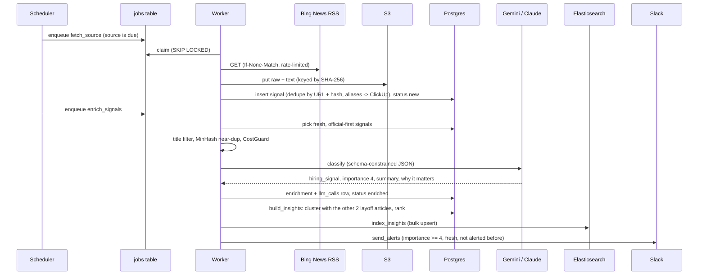

# Interview notes

Plain-English explanations of Signal Scout, for talking about it live. Every number here is in
`docs/results/` or `docs/EVALS.md`; if a number isn't measured yet, say so.

## 30-second pitch

Signal Scout is a small version of what Klue builds. It watches competitors' news, press releases,
changelogs, Hacker News and pricing pages, filters out the noise cheaply, has an LLM classify what each
remaining signal means and why it matters for a sales rep, groups duplicate coverage into ranked insights,
and serves them through search, a REST API, Slack alerts, signed webhooks, and an MCP server so AI agents
can ask questions in plain language. It's Python, FastAPI, Postgres, Elasticsearch and S3, with
Gemini or Claude behind one interface.

## 2-minute deep dive

- **Ingestion.** A scheduler enqueues jobs into a Postgres table; workers claim them with
  `SELECT ... FOR UPDATE SKIP LOCKED`. Feeds are fetched politely (identifying User-Agent, `robots.txt`
  checked, conditional GETs, per-domain token bucket, retries with jitter, circuit breaker). Raw bytes
  and extracted text go to S3, content-addressed by SHA-256; Postgres stores metadata and a short excerpt.
- **Cost control before the LLM.** Exact dedupe (canonical URL, content hash), MinHash near-duplicate
  detection, case-sensitive competitor aliases, and low-value title patterns. On 101 labeled signals the
  title filter drops 16 of 35 irrelevant ones and none of the 66 relevant ones.
- **Enrichment.** One `LLMClient` interface, Gemini and Claude adapters, one JSON schema, Pydantic
  validation, one retry, then mark failed. Prompts are versioned and evaluated: v3 keeps 100% of
  important signals in the feed with 62% exact importance accuracy.
- **Insights.** Signals about the same event (same competitor, within 72 h, TF-IDF similarity ≥ 0.2)
  become one insight, ranked by importance × recency × source weight × corroboration × novelty.
- **Serving.** Elasticsearch blends BM25 with the rank score; the API and MCP server share one service
  layer. Postgres is the source of truth, and the index rebuilds from it with identical results (tested).
- **Ops.** Every job writes a `job_runs` row; Prometheus metrics and a Grafana dashboard show volume,
  funnel, spend and latency; four alert rules. Everything runs in Docker with one image and CI.

## One signal, end to end

Example: ClickUp lays off 22% of staff and Bing News publishes it.

## Each technology: what, why, alternative, why not

| Tech | What it is | Why here | Alternative | Why not |
|---|---|---|---|---|
| Python 3.12 + uv | Language + fast, lockfile-based package manager | Klue's stack; uv gives reproducible installs in seconds | Poetry | Slower; uv's lockfile + Docker story is simpler |
| FastAPI | Async web framework with typed request/response models | OpenAPI docs for free, Pydantic validation, async DB/ES clients | Flask, Django | Sync by default; more boilerplate for typed APIs |
| PostgreSQL 16 | Relational database | Source of truth for everything, and the job queue (`SKIP LOCKED`) | MongoDB | Relational data (signals ↔ insights ↔ deliveries) and constraints matter |
| SQLAlchemy 2 + Alembic | ORM + migrations | Typed async queries; reviewable, reversible schema changes | Raw SQL | Harder to evolve safely; migrations are tested down/up |
| Elasticsearch 8 | Search engine | BM25 + custom scoring, stemming, highlights, autocomplete; keeps search load off Postgres | Postgres full-text | No easy relevance blending; competes with pipeline writes |
| S3 (MinIO locally) | Object storage | Raw pages are big and immutable; content addressing dedupes storage | Postgres `bytea` | Bloats the database and its backups |
| Gemini / Claude | LLMs | Classification + summaries; Gemini Flash-Lite is free; Claude Haiku via the same interface | A fine-tuned classifier | No labeled data at the start; LLM + eval is faster to validate |
| MCP | Open protocol letting AI agents call tools | Lets Claude or other agents query the intel with typed, documented tools | A custom plugin per assistant | MCP works across clients |
| Prometheus + Grafana | Metrics + dashboards | Standard, self-hosted, alert rules as code | Datadog | Paid; overkill here |
| Docker Compose | Multi-container local stack | One command for the whole system, same image everywhere | Kubernetes | Unnecessary for one machine |

## 25 questions with model answers

1. **Why dedupe and filter before calling the LLM?** The LLM is the only step with a per-call cost or
   quota, and most fetched items are duplicates or don't mention a competitor. Filtering first means the
   quota goes to signals that can matter. Measured: the title filter alone removes 16 of 35 irrelevant
   eval signals with no false drops.
2. **How do you get reliable JSON out of an LLM?** Constrain it and then validate it. Gemini gets a JSON
   response schema; Claude gets a strict tool it must call. Pydantic then checks what schemas can't
   (ranges, lengths, competitors limited to the tracked list). On failure: retry once, then mark the
   signal `enrichment_failed` and move on. 404 real calls, 0 failures.
3. **How did you evaluate output quality?** 101 real signals with gold labels (relevance, competitor,
   category, importance). A script scores any provider/model/prompt. The key move was scoring what
   reaches the feed, not just aggregate accuracy: v2 had the best accuracy but dropped two important
   pricing signals, so v3 became the default. Caveat: labels are drafted, pending human review, and
   there's no held-out set yet.
4. **How do you control cost?** Cheap model (Flash-Lite free tier, or Haiku), filters before the LLM, a
   prioritized queue, a client-side rate limiter persisted across restarts, and CostGuard: it sums
   `llm_calls.cost_usd` and refuses calls past $0.50/day or $4.50 total. Total spend so far: $0.
5. **What is prompt caching?** The provider stores the processed prefix of a prompt (here, the ~1,600-token
   system prompt with rubric and examples), so repeated calls read it at about a tenth of the price. The
   Claude adapter marks it with `cache_control`; Gemini caches implicitly (but not on Flash-Lite's free tier).
6. **What is the Batch API?** Asynchronous bulk requests at about half price, results within hours. Good
   for a historical backfill. Not used yet because the free Gemini tier costs nothing; it's the next step
   for Claude.
7. **What is MCP, and how is it different from a REST API?** REST is for programs that know your API.
   MCP is a standard way for AI agents to discover and call tools: each tool has a name, a description and
   a typed schema the model reads, so an agent can decide by itself to call `get_competitor_brief("ClickUp")`.
   Same service layer underneath, so no duplicated logic.
8. **How do you secure webhooks?** HMAC-SHA256 over `timestamp.body` with a shared secret, a
   constant-time comparison, and rejection of timestamps older than 5 minutes so captured requests can't
   be replayed. Outbound deliveries are signed the same way and carry an idempotency key.
9. **Why Elasticsearch over Postgres full-text?** Relevance tuning (BM25 × rank score via
   `function_score`), stemming, highlighting, autocomplete, and isolation of search load from pipeline
   writes. Postgres stays the source of truth.
10. **How would you get p95 under 200 ms?** Filters in filter context (cached), one shard at this size,
    `_source` filtering, connection reuse, and a TTL cache for repeated queries if needed. The load test
    is built; the at-scale run is pending, so I don't quote a p95 yet.
11. **What happens if Elasticsearch dies?** Ingestion and enrichment keep working (they only write to
    Postgres and S3); `/readyz` reports ES as down; search returns errors. When it's back, `make reindex`
    rebuilds the index from Postgres. That's tested: identical results after deleting the index.
12. **How do you know the pipeline ran today?** `job_runs` has a row for every execution, `make
    runs-report` summarizes the last 24 h, Grafana shows it, and `NoSignalsIngested` fires after 2 hours
    without new signals.
13. **How would this handle 10× the sources?** The workers scale horizontally (`SKIP LOCKED`), ingestion
    is I/O-bound and polite per domain, and the LLM is the real limit. You'd add a shared rate limiter
    (Redis), more quota or a batch API, separate worker pools per job type, then move the queue to SQS/Kafka.
14. **Multi-tenant customers?** A tenant id on every row and index (or per-tenant aliases), per-tenant
    competitor sets and budgets, row-level security in Postgres, and tenant-aware caching and rate limits.
15. **What did the AI coding tool get wrong, and how did you catch it?** It wrote a test fixture's URL
    from memory and labeled it real (caught by checking the cached data). Its first adapters crashed on a
    503 (caught by a live run). It used an attribute outside the interface (caught by the end-to-end
    test). And it seeded a too-broad `Linear` query (caught by watching per-source volumes).
16. **Why a Postgres queue instead of Celery or Kafka?** Fewer moving parts at this volume, transactional
    enqueue alongside other writes, and the queue is inspectable with SQL. At Klue's scale I'd move to
    SQS or Kafka.
17. **How does clustering work?** Same competitor, within 72 hours, TF-IDF cosine ≥ 0.2 on title + LLM
    summary. Category is ignored because the LLM labels the same news differently across articles.
    Measured: 10 multi-article clusters instead of 5, no false merges found by review.
18. **How is ranking computed?** importance × 0.5^(age / 7 days) × source weight × (1 + ln n) × novelty.
    The half-life was 48 h until measurement showed a minor post outranking a major pricing change.
19. **How do you detect pricing-page changes without false alarms?** Extract main text, drop cookie and
    copyright lines, replace dates and IDs, then hash. Changes that are only punctuation or case are
    ignored, but digits always count: "$10" → "$12" is one character and exactly what matters.
20. **What's in S3 vs Postgres?** S3: raw HTML/JSON and extracted text, gzipped, keyed by hash. Postgres:
    metadata, a 500-character excerpt, enrichment, insights, job runs, deliveries.
21. **How do you avoid alerting twice?** `insights.slack_alerted_at` for Slack, and a unique constraint
    on `(insight_id, subscription_id)` for webhooks. Only fresh insights alert, so a backfill can't flood Slack.
22. **How do you test without calling the LLM?** A `FakeLLMClient` for pipeline tests, and the real
    adapters tested against replayed API responses in the SDKs' own types (including a real 503 body).
    Integration tests run on real Postgres, MinIO and Elasticsearch via testcontainers.
23. **How do you make migrations safe?** Additive only (nullable or defaulted columns), applied to a
    live database with data, and a test that checks models match migrations and that they downgrade and
    upgrade cleanly.
24. **Why Gemini instead of Claude?** Budget: Gemini's free tier costs $0. The code is provider-agnostic
    and the Claude adapter is fully tested; running the Claude eval for a side-by-side comparison is the
    next step once there's an API key.
25. **What would you do differently?** Start with a held-out eval set and human labels on day one;
    verify each source's yield before backfilling; and check the volume target against legitimate
    sources earlier. 25K news-type signals turned out to be more than free sources provide quickly.

## Things I'd build next

1. Full-article fetching (where `robots.txt` allows) so the LLM sees more than a snippet.
2. A held-out, human-labeled eval set from the live pipeline, and the Claude vs Gemini comparison.
3. Embedding-based clustering to merge stories that share no words.
4. Per-competitor battlecard pages generated from the week's top insights.
5. A small React dashboard: search box, insight feed, competitor filter.

## Glossary

- **Signal:** one raw item (article, release note, HN story, page diff).
- **Insight:** a cluster of signals about one event, with a headline, summary and rank.
- **BM25:** the standard text-relevance formula search engines use.
- **MinHash / LSH:** a compact fingerprint of a document's word shingles, and an index that finds
  near-identical fingerprints quickly.
- **TF-IDF:** word weights that favor words specific to a document over words common to all of them.
- **SKIP LOCKED:** a Postgres clause that lets many workers claim different rows without blocking.
- **HMAC:** a keyed hash proving a message came from someone with the shared secret and wasn't altered.
- **p95:** the latency 95% of requests come in under.
- **MCP:** Model Context Protocol, a standard for exposing tools and data to AI agents.
